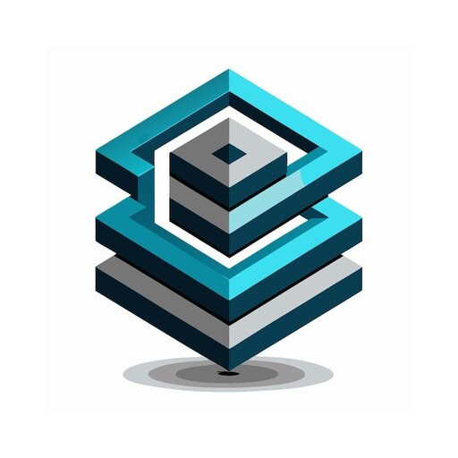
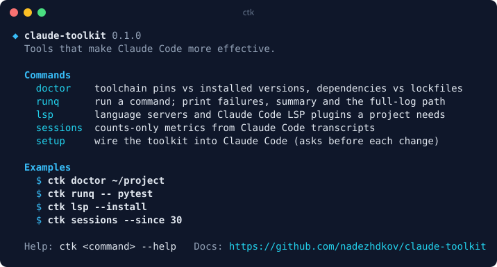
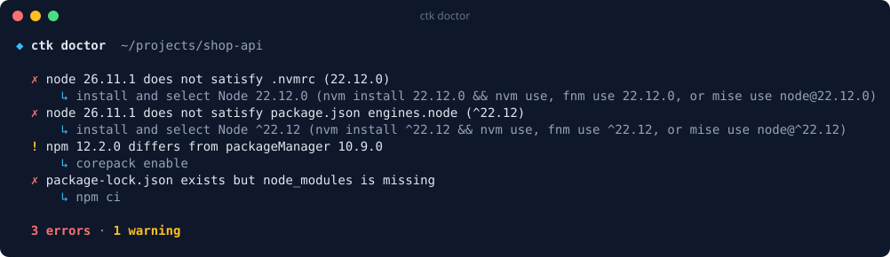
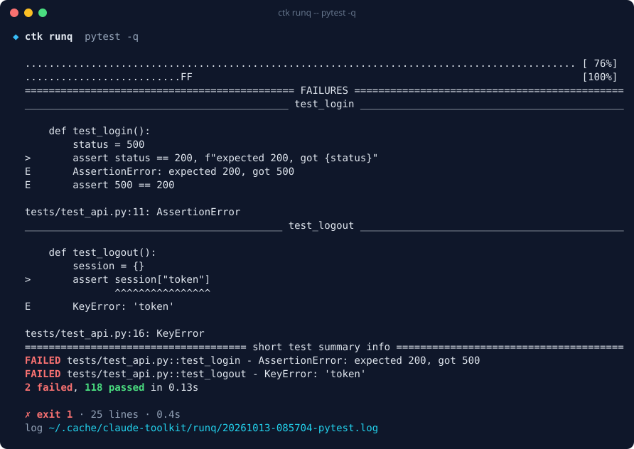
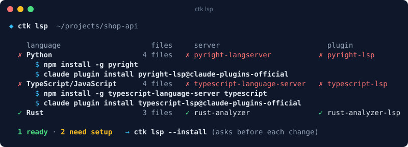
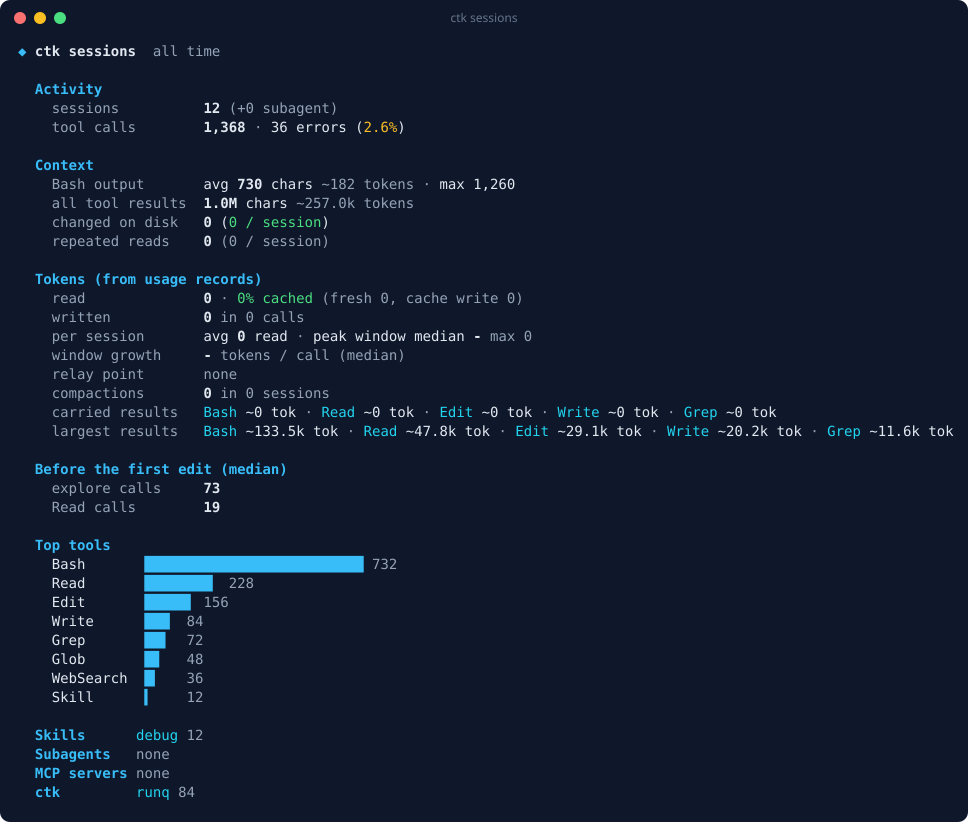

<div align="center">



# claude-toolkit

**General-purpose tools, hooks, skills and subagents that make Claude Code more effective in any project.**

[](https://github.com/nadezhdkov/claude-toolkit/actions/workflows/ci.yml)
[](docs/CHANGELOG.md)
[](LICENSE)

[](https://www.python.org/)
[](https://docs.claude.com/en/docs/claude-code)
[](https://docs.astral.sh/uv/)
[](https://github.com/astral-sh/ruff)
[](pyproject.toml)
[](install.sh)

[Why](#why) · [Install](#install) · [Commands](#commands) · [Roadmap](docs/roadmap.md) · [Design](docs/design.md) · [Contributing](CONTRIBUTING.md)

</div>

---

## Why

AI coding agents lose time and make mistakes in the same places in almost
every project. claude-toolkit targets four of them, each measured on real
Claude Code sessions:

| Pain | Example | Tool |
|---|---|---|
| Builds and tests fail for environment reasons | Node 26 installed while the repo pins 24; `node_modules` missing | `ctk doctor` |
| Long command output floods the context window | Thousands of test lines to find three failures | `ctk runq` |
| Code navigation by grep instead of definitions | Dozens of file reads to find one pattern | `ctk lsp` |
| No way to tell whether a change helped | "It feels faster" | `ctk sessions` |

Every tool follows the same rules: it is **fast**, **quiet when everything is
fine**, and **never changes your system without asking**. Without a terminal
(for example when Claude runs it) a change prints its plan and exits with code
`3`, so a person approves it and reruns with `--yes`.

Output is **styled for people and plain for agents**: colours, charts and a
progress spinner appear only on an interactive terminal; pipes, logs and
Claude Code get compact plain text. `NO_COLOR` turns colour off and
`FORCE_COLOR` turns it on.

## Install

Requirements: Linux or macOS, `git`, and [uv](https://docs.astral.sh/uv/)
(the installer offers to install uv if it is missing). The `ctk` command has no
runtime dependencies beyond Python 3.11+.

```bash
git clone https://github.com/nadezhdkov/claude-toolkit.git
cd claude-toolkit
./install.sh            # shows the plan, asks before each step
```

The installer runs `uv tool install --editable .` (so `git pull` updates
`ctk`) and then `ctk setup`, which adds a short section to
`~/.claude/CLAUDE.md` telling Claude Code when to use each command (with a
backup) and offers to install missing optional dependencies.
See [docs/installation.md](docs/installation.md) for manual steps, updating
and uninstalling.

## Commands

Run `ctk` on its own for an overview:



| Command | What it does |
|---|---|
| [`ctk doctor`](docs/commands/doctor.md) | Toolchain pins vs installed versions, and dependencies vs lockfiles |
| [`ctk runq`](docs/commands/runq.md) | Runs a command; prints failures, summary and the full-log path |
| [`ctk lsp`](docs/commands/lsp.md) | Language servers and Claude Code LSP plugins a project needs |
| [`ctk sessions`](docs/commands/sessions.md) | Counts-only metrics from Claude Code transcripts |
| [`ctk shoot`](docs/commands/shoot.md) | Deterministic screenshots of web pages, Godot scenes and desktop apps; baselines and contact sheets |
| [`ctk audiocheck`](docs/commands/audiocheck.md) | Loudness, clipping, silence and loop seams of audio files, with waveform and spectrogram images |
| [`ctk sandbox`](docs/commands/sandbox.md) | Runs untrusted code without network, with a read-only system, an empty home and resource limits |
| [`ctk libdocs`](docs/commands/libdocs.md) | Installed version, declared constraint, README and API of a dependency; where a symbol is defined |
| [`ctk setup`](docs/installation.md#what-ctk-setup-changes) | Wires the toolkit into Claude Code, asking before each change |
| [`ctk hook`](docs/commands/hooks.md) | Logic behind the plugin hooks (event JSON on stdin) |

### `ctk doctor` — environment check

Compares a project's pinned toolchain (`.nvmrc`, `.node-version`,
`package.json` `engines` and `packageManager`, `.python-version`,
`requires-python`, `go.mod`, `rust-toolchain`, `.tool-versions`) with what is
installed, and checks that dependencies match the lockfile.



`ctk doctor --toolkit` checks the toolkit's own dependencies, with install
commands for your distribution.

### `ctk runq` — command output without the noise

Runs a command, saves the full output to a log and prints only failures, the
summary and the log path. Short output is printed unchanged and the exit code
is always preserved. Recognises pytest, vitest/jest, tsc, ruff/eslint, cargo,
go test and gradle, with a generic fallback.



### `ctk lsp` — language servers

Detects the project's languages and reports whether each has its language
server binary and its official Claude Code LSP plugin; `--install` installs
the missing pieces, asking before each one.



### `ctk sessions` — measure what helps

Reads Claude Code transcripts (`~/.claude/projects`) and reports **counts
only**: tool calls and errors, exploration before the first edit, command
output sizes, "file changed on disk" notices, and use of skills, subagents,
MCP servers and `ctk`. `--csv -` prints weekly rows for before/after
comparisons. Message text is never copied.



### `ctk shoot`: see what changed

Deterministic screenshots, so Claude can look at the UI it just changed:
web pages through Playwright's Chromium (frozen animations, fixed viewport,
time zone and locale), Godot 4 scenes through the movie writer, and any desktop
program on a private Xvfb display. `--baseline` compares with a reference
image, with a threshold, a tolerance and masks, and writes a diff image with
the bounding box of the change. `ctk shoot sheet` combines several captures
into one numbered contact sheet.

```bash
ctk shoot web localhost:5173 --baseline shots/home.png
ctk shoot godot . --scene res://ui/menu.tscn
```

### `ctk audiocheck`: hear problems without listening

Measures loudness (EBU R128) and true peak, finds clipping (even when
attenuated afterwards), silent files, silence at the edges and DC offset, and
with `--loop` detects clicks at the loop point. `--images` writes a waveform
and a spectrogram per file.

```bash
ctk audiocheck assets/audio --target -16 --images
```

### `ctk sandbox`: run untrusted code safely

Runs a command with bubblewrap: no network, the system read-only, an empty
home (no SSH keys or tokens), only the project directory writable, a cleared
environment, and memory, CPU, process and time limits.

```bash
ctk sandbox -- npm test
ctk sandbox --dir ~/src/unknown-repo --timeout 300 -- make
```

### `ctk libdocs`: the API you actually have

Reads a dependency from its installed files (Python, Node, Rust, Go) and shows
the installed version next to the declared constraint, the README and the
public API; `--find` prints a symbol's definition with its signature and docs.
Nothing from the package is imported or run.

```bash
ctk libdocs pydantic --find BaseModel.model_dump
```

## Hooks plugin

The `ctk` Claude Code plugin adds hooks that run outside the conversation and
cost no context. They stay silent when all is well and skip projects they do
not apply to:

| Hook | What it does |
|---|---|
| `format-file` | formats the file Claude just edited with the project's own formatter (ruff, black, prettier, biome, rustfmt, gofmt, stylua, clang-format) |
| `affected-tests` | at the end of a turn, runs the tests related to the edited files; on failure Claude keeps working with the digest |
| `guard-destructive` | flags `rm -rf` outside the project, force-push to `main` and `git reset --hard` over uncommitted work (warn-only until you switch it to block) |
| `secrets` | runs `gitleaks` before `git commit` and denies commits with secrets |
| `notify` | desktop notification when Claude Code waits for you or a long turn ends |

`ctk setup` installs it, asking first; by hand:

```bash
claude plugin marketplace add nadezhdkov/claude-toolkit
claude plugin install ctk@ctk
```

Per-project settings and opt-out live in `.claude-toolkit.toml`; see
[docs/commands/hooks.md](docs/commands/hooks.md).

## Skills

The plugin also ships process skills that Claude loads when a task fits, or
that you call as `/ctk:<name>`: `debug` (root cause before fix), `ship`
(checks, review, PR), `handoff` (progress file across sessions),
`onboard-repo`, `visual-qa` (look at screenshots before calling UI work done)
and `security-pass`. They defer to a project's own process when it has one.
See [docs/skills.md](docs/skills.md).

## Roadmap

`0.1.0` shipped the foundation: `doctor`, `runq`, `lsp`, `sessions` and the
installer; then came the quality hooks plugin, `ctk shoot`, `ctk audiocheck` and
the process skills, `ctk sandbox` and `ctk libdocs`. Next come subagents with
output contracts. See [docs/roadmap.md](docs/roadmap.md).

## Development

```bash
uv sync                                               # dev environment
uv run ruff check . && uv run ruff format --check .   # lint and format
uv run pytest                                         # tests
uv run ctk doctor                                     # run the CLI from the checkout
```

Pull requests run lint, shellcheck, tests on Python 3.11–3.13, an install
smoke test, a Conventional Commits title check and a changelog check;
maintainers merge with the `automerge` label. See
[CONTRIBUTING.md](CONTRIBUTING.md) and [AGENTS.md](AGENTS.md).

## License

[MIT](LICENSE)
